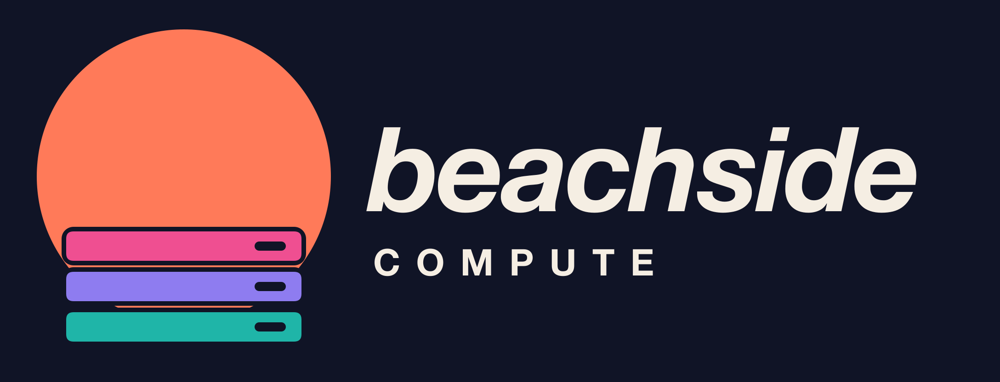

# Beachside Compute — Sunset Stack

The parent-company identity pairs a sunset with three compute-server bars.

## Files

- `github-avatar.png`: upload-ready 1024 × 1024 organization avatar, navy background with padding for circular crops. Editable master: `github-avatar.svg`.
- `logo-navy.svg` / `.png`: full horizontal logo on navy (PNG: 2176 × 832).
- `logo-on-dark.svg` / `.png`: transparent horizontal logo with cream lettering.
- `logo-on-light.svg` / `.png`: transparent horizontal logo with navy lettering.
- `mark.svg` / `.png`: transparent standalone color symbol (PNG: 1024 × 1024).
- `mark-monochrome.svg`: single-color navy symbol; change its fills for other one-color applications.

SVGs are the editable vector masters. All lettering is outlined, with no font dependencies or external resources. PNGs are sRGB exports. Status slots are true transparent cutouts. A mask keeps the sun clear of the server trays, preserving transparent separation and slots. Keep the symbol proportions and leave clear space around the artwork; use the symbol alone for avatars and small placements.

## Palette and construction

Coral `#ff7a59`, pink `#ef4f91`, lavender `#8e7cf0`, and aqua `#1fb5a8` match the Beachside docs brand tokens. Navy is `#101426`; cream is `#f5eee3`.

The symbol uses a 320-unit sun disk (25% wider than the 256-unit server bars) behind three 32-unit foreground bars, separated by 12-unit gaps. Each bar has a 34 × 10-unit rounded status cutout. The wordmark was outlined from Helvetica Neue Bold Italic; COMPUTE from Helvetica Neue Bold with expanded tracking.

These production assets are a geometric SVG reconstruction of the selected AI-generated Sunset Stack concept. The PNGs were rendered from the SVG masters. Visually checked at full size and with the avatar at 64 × 64. Assets live here independently of the website.
